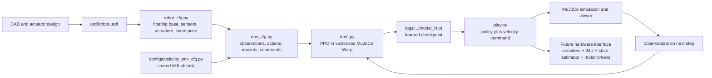
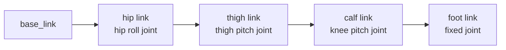

# Build and Train a Custom Quadruped with MJLab

This guide walks through the **Robodog project in this folder** from its robot model to a trained walking policy. It explains what each file does, how the simulator and policy fit together, how to run the project, and what would still be needed to use the policy on a physical robot.

It describes the code as it exists in this checkout. It is not a claim that the current simplified model is a production-ready Go2 model or that the policy is ready to run on hardware.

## Contents

1. [The complete pipeline](#1-the-complete-pipeline)
2. [Project files and what each one does](#2-project-files-and-what-each-one-does)
3. [Robot model: links, joints, collisions, and frames](#3-robot-model-links-joints-collisions-and-frames)
4. [From robot model to MJLab environment](#4-from-robot-model-to-mjlab-environment)
5. [What the policy observes and controls](#5-what-the-policy-observes-and-controls)
6. [Commands, rewards, resets, and randomization](#6-commands-rewards-resets-and-randomization)
7. [Training with PPO](#7-training-with-ppo)
8. [Playing a trained policy](#8-playing-a-trained-policy)
9. [Validation and non-RL motion tools](#9-validation-and-non-rl-motion-tools)
10. [Changing the robot or task safely](#10-changing-the-robot-or-task-safely)
11. [What is needed for a real robot](#11-what-is-needed-for-a-real-robot)
12. [Common problems and how to investigate them](#12-common-problems-and-how-to-investigate-them)
13. [Glossary and further reading](#13-glossary-and-further-reading)

---

## 1. The complete pipeline

A custom walking robot needs several pieces to agree: its geometry, joint names and directions, physics, observations, actions, and the real motor interface. MJLab does not replace the robot model or motor drivers; it runs the learning environment and policy training.



During training, the loop is:

1. The environment gives the actor an observation and a desired velocity command.
2. The actor neural network produces 12 joint-position actions.
3. The actuator model turns target positions into motor torques through position control.
4. MuJoCo advances the robot and reports the next state and reward.
5. PPO updates the actor and critic to improve the expected reward.

At playback, the trained actor still produces the joint actions. A person or an automatic command generator supplies the desired walking speed. The keyboard does **not** directly move individual joints.

---

## 2. Project files and what each one does

Run commands from the project directory:

```bash
cd ~/robotics/quatrain-walking-robot
```

Install MJLab in a sibling `mjlab` checkout as described in `README.md`; run project commands with `uv --project ../mjlab`. GPU training needs a supported NVIDIA GPU, driver, and CUDA-compatible dependencies. If no supported GPU is available, `train.py --cpu` can run a small configuration check, but full PPO training will be much slower.

| File or folder | Purpose | Edit it when… |
|---|---|---|
| `urdf/robot.urdf` | Active robot description: links, joint tree, visual and collision geometry, inertias, joint axes, limits, and masses. | Changing robot geometry or kinematic structure. |
| `robot_cfg.py` | Turns the URDF into the MJLab robot entity; adds the floating base, IMU-related simulation sensors, foot sites, actuators, initial state, and action scales. | Changing the simulation setup of the robot, standing angles, actuator gains, or action scale. |
| `configs/velocity_env_cfg.py` | Project-local copy/factory for the general velocity-tracking environment settings inherited from the MJLab task. Includes base observations, commands, rewards, events, and simulation defaults. | Changing shared velocity-task defaults that the Robodog task inherits. |
| `configs/__init__.py` | Makes `configs` a Python package so its modules can be imported. | Usually no change needed. |
| `env_cfg.py` | Defines the Robodog-specific flat-ground task. Connects the robot, selects sensors and observations, adjusts rewards and limits, registers the task, and configures the PPO network. | Changing what the policy sees, the terrain, rewards, terminations, domain randomization, command ranges, or PPO settings. |
| `train.py` | Command-line entry point that loads the registered task and PPO configuration, sets environment count and iteration count, selects GPU/CPU, and starts training. | Adding training CLI options or changing run setup. |
| `play.py` | Loads a trained checkpoint and opens the viewer. Includes keyboard velocity control and a toggle to automatic generated commands. | Changing playback controls or policy evaluation behavior. |
| `inspect_robot.py` | Compiles and checks the robot, joint limits, nominal standing pose, collision contacts, and a gravity-drop smoke test. Can export an MJCF scene. | Adding or changing model diagnostics. |
| `check_model.py` | A simpler URDF/MuJoCo viewer and exporter. Builds a floating-base ground scene and can display it. | Debugging the raw URDF or exporting a scene for inspection. |
| `walk_test.py` | Hand-coded, non-RL gait and standing tests. It is separate from PPO. Has standing and knee-only diagnostic modes. | Experimenting with a procedural gait or basic joint behavior without training. |
| `README.md` | Short quick-start commands and the keyboard mapping. | Keeping the project entry point current. |
| `GUIDE.md` | This detailed explanation of the project and workflow. | Expanding the learning notes. |
| `urdf/robot_original_8dof.urdf` | Older 8-DOF model kept for reference. | Normally do not edit for current training; it is not the active model. |
| `urdf/robot_scene.xml` | Generated MuJoCo XML export from `check_model.py` (its default export path). It can be regenerated and may be stale. | Do not treat as the active robot source; regenerate it when you specifically need an export. |
| `robot_debug_bundle.txt` | Local diagnostic snapshot; not included in the repository. | Regenerate only when you need a fresh snapshot. |
| `logs/quatrain_walking_robot/robodog_velocity/` | The published `model_4999.pt` checkpoint and ONNX policy. Other generated training logs are excluded from Git. | Training runs create local outputs in this directory. |
| `.venv` | Local environment directory created by `uv` (ignored by Git). | Recreated by the install steps in `README.md`. |
| `__pycache__/` and `configs/__pycache__/` | Python-generated bytecode caches. They are not source files and can be recreated. | Do not edit them. |

### Which robot file is actually used?

The active path is:

```text
train.py / play.py
  -> task registered in env_cfg.py
  -> get_robodog_robot_cfg() in robot_cfg.py
  -> urdf/robot.urdf
```

`robot_scene.xml` is only an export. Editing that file alone does not change the model loaded by `robot_cfg.py`.

### The neighboring MJLab checkout

The sibling `mjlab` checkout supplies the MJLab framework, the shared task implementation, the GPU-accelerated MuJoCo Warp simulator, and the Python environment used by `uv run --project ../mjlab`. This robot project registers a custom task into that framework. MJLab itself is not copied into this folder.

---

## 3. Robot model: links, joints, collisions, and frames

### Links and joints

The active model is a floating-base quadruped with four legs and three revolute joints per leg: 12 actuated joints total. The body names use:

- `FL`: front left
- `FR`: front right
- `RL`: rear left
- `RR`: rear right

Each leg has a hip-roll joint, thigh-pitch joint, and calf/knee-pitch joint. The names in the URDF matter: configuration patterns such as `.*_calf_joint` select joints by name.

The model includes 13 joints when compiled for simulation: a 6-degree-of-freedom free joint for the trunk plus the 12 leg hinges. A URDF alone does not necessarily make the base float in MuJoCo; `robot_cfg.py` explicitly adds the free joint.

### Coordinate and angle conventions

The model is treated as facing along +X, with the left side at +Y and up along +Z. Joint angles in the URDF are in radians. Always verify the frame and sign convention against the rendered model before changing gait or limits.

The current URDF uses approximately these joint limits:

| Joint group | Axis | Limits |
|---|---|---:|
| Hip roll | X | −1.0472 to +1.0472 rad |
| Front thigh | Y | −1.5708 to +3.4907 rad |
| Rear thigh | Y | −0.5236 to +4.5379 rad |
| Calf/knee | Y | −2.7227 to −0.83776 rad |

The rear thigh limits differ from the front thigh limits. Do not assume the same range for all 12 joints. These values were chosen to follow a Go2-style convention, but the robot is a simplified custom model; they do not make it a dimensionally exact Unitree Go2.

The current hip pivot origins are at X = +0.234 m for the front and X = −0.234 m for the rear. They were moved to fit this project’s chassis ends. This intentionally differs from stock Go2 dimensions.

### Kinematic chain and approximate geometry

Each side follows the same parent-child pattern:



This chain is repeated for FL, FR, RL, and RR. The hinge origin is the pivot: moving a visual box does not move the hinge itself.

| Part | Approximate model geometry / mass |
|---|---|
| Trunk | 0.38 × 0.18 × 0.10 m box; 5.20 kg |
| Hip motor housing | 0.04 m cylinder length, 0.046 m radius; 0.68 kg per leg |
| Thigh link | 0.213 m pivot spacing; 0.18 m orange box length, 0.045 × 0.035 m section; 1.00 kg per leg |
| Calf link | 0.213 m cylinder length, 0.012 m radius; current visual/collision center is Z = −0.09 m; 0.20 kg per leg |
| Foot | 0.025 m radius sphere; 0.06 kg per leg |

Adding the link masses gives about 12.96 kg (roughly 13 kg). This is only as accurate as the values in the URDF; it is not a measured hardware mass.

### Visual, collision, and inertial geometry

A link may define three different things:

- **Visual geometry:** what appears in the viewer.
- **Collision geometry:** what contacts the ground or other links in physics.
- **Inertial properties:** mass, center of mass, and inertia tensor used in dynamics.

Changing a visual origin does not automatically move the joint, collision shape, or center of mass. If a motor appears detached, inspect the joint origin and visual/collision origins separately. If a leg passes through another part, inspect collision geometry and the simulator’s contact filtering, not just the appearance.

This robot’s geometry is simplified: orange boxes represent the trunk/thigh structure, dark cylinders represent hip motors, black cylinders represent calves, and spheres represent feet. The thigh body pivot-to-pivot length is 0.213 m, while the visible/collision orange box is shortened near the knee to leave room for the joint. The dark knee visual helps show that hinge.

### Joint tree, not just object placement

In URDF, each joint connects one parent link to one child link. Its `<origin>` locates the child frame relative to the parent frame. The child link geometry is then described relative to that child frame. To move a whole leg assembly, change the relevant joint origin. To move only a rendered motor casing, change its visual origin, and separately check the collision origin. Keeping those transformations aligned is important.

### Collision caveat in this checkout

MuJoCo normally filters collisions between a body and its direct parent. `walk_test.py` and `inspect_robot.py` add explicit thigh–calf contact pairs, so those tools can detect knee interference. `robot_cfg.py` currently loads the URDF without adding those explicit pairs. That means the RL environment may not enforce the same thigh–calf contact behavior as those diagnostic scripts. If knee/thigh collision behavior matters to a new training run, add and verify the pairs in `robot_cfg.py` as well; changing that after training changes the simulated task and warrants a new policy.

---

## 4. From robot model to MJLab environment

### `robot_cfg.py`: the robot as a simulated system

`get_robodog_spec()` loads `urdf/robot.urdf`, adds a free joint to `base_link`, adds an IMU site and MuJoCo sensor definitions, and adds foot sites. The simulation’s `imu_lin_vel` is a MuJoCo velocimeter, which provides simulator ground-truth body velocity. A real IMU does not directly provide clean linear velocity; real hardware needs a state estimator to produce a comparable policy input.

`INIT_STATE` puts the robot at trunk height 0.322 m with hip = 0, thigh = +0.80 rad, calf = −1.60 rad, and zero joint velocity. This is a supplied initial standing posture. The policy does not discover this safe pose from scratch.dd

The position actuators use the following values:

| Group | Stiffness (`Kp`) | Damping (`Kd`) | Effort limit |
|---|---:|---:|---:|
| Hips and thighs | 80 | 4 | 23.7 N·m |
| Calves | 100 | 5 | 45.43 N·m |

These are simulation parameters, not a confirmed motor specification for a physical build. Real actuator gains, torque, speed, gearing, and thermal limits must come from the selected hardware.

### `configs/velocity_env_cfg.py`: shared task template

This file builds a general velocity-tracking task. It defines the terms that the robot-specific configuration starts from, such as observations, action type, random velocity commands, rewards, resets, and domain randomization. It also defines the shared simulation timing and base terrain setup.

### `env_cfg.py`: this robot’s learning problem

`robodog_flat_env_cfg()` takes that shared task and adapts it:

- Adds the Robodog entity from `robot_cfg.py`.
- Uses a flat plane rather than generated rough terrain.
- Configures four foot-ground contact sensors.
- Removes terrain-height observations and height-dependent rewards from this flat task.
- Sets robot-specific pose tolerances, trunk references, and action scales.
- Keeps a timeout and a fall termination (body tilt greater than 70 degrees).
- Adds this project’s task ID, `Mjlab-Velocity-Flat-Robodog`, to MJLab’s task registry.

The PPO runner uses an actor and critic MLP with hidden layers `(512, 256, 128)`, ELU activations, and observation normalization. Its PPO settings include 24 policy steps per environment per iteration, 5 learning epochs, 4 minibatches, and checkpoint saves every 50 iterations.

### Training simulation timing

The shared environment uses a physics step of 0.005 seconds (200 physics updates per simulated second) and a decimation of 4. The policy receives one observation and issues one action every 0.020 seconds, or 50 policy updates per simulated second. In real hardware, the policy/control loop and the motor servo loop may run at different rates and must be designed deliberately.

---

## 5. What the policy observes and controls

### Actor observations: 48 values

The deployed walking policy (the **actor**) receives 48 numbers, not a camera image. The observation is the concatenation of these terms:

| Observation | Size | Meaning |
|---|---:|---|
| Base linear velocity | 3 | Body-frame translational velocity. In simulation this comes from the MuJoCo velocimeter. |
| Base angular velocity | 3 | Roll, pitch, and yaw rates from the simulated gyro. |
| Projected gravity | 3 | Direction of gravity in the robot frame; indicates body orientation/tilt. |
| Relative joint positions | 12 | Current joint angles relative to their configured defaults. Encoder bias/noise is included in training. |
| Joint velocities | 12 | Rotational speed of the 12 joints. |
| Previous action | 12 | The last policy output, giving the actor short-term action history. |
| Velocity command | 3 | Desired forward speed, sideways speed, and yaw rate. |
| **Total** | **48** | The actor network input size. |

During training, observation corruption is enabled. The config adds uniform noise to base velocity, gyro, gravity, joint positions, and joint velocities, and the startup event randomizes encoder bias. During play, actor observation corruption is disabled.

### Critic observations: 68 values

The **critic** is used to estimate how good a state is while PPO is training. It shares the actor’s main state information but gets privileged simulation-only information: true unbiased joint positions, four foot airtimes, four foot contact values, and 12 contact-force values. The flat-ground task removes height scans and foot-height data, leaving 20 extra values beyond the actor’s 48.

The deployed policy uses the actor. It does not require foot force sensors as direct policy inputs with the current observation definition. Foot contacts can still help a real robot’s state estimator, and a future policy can be designed to use them if they are added consistently to training and deployment.

### Actions: 12 joint position targets

The actor outputs one normalized action for each of the 12 joints. The `JointPositionActionCfg` uses default joint-position offsets, so actions become offsets around the configured standing joint pose rather than absolute raw motor torques. The per-joint scales are about 0.074 rad for hips/thighs and 0.114 rad for calves.

The position actuators then track those targets using stiffness/damping and effort limits. This is why the learned network outputs joint targets while the simulated actuator creates torques. A real robot needs a low-level position/torque controller or motor interface that matches this behavior closely.

### Inputs a real implementation must provide

To reproduce the actor input on hardware, the minimum state information is:

- 12 motor encoder positions and velocities.
- A body IMU for angular velocity and orientation/gravity estimate.
- A body linear-velocity estimate. This generally requires sensor fusion (for example, IMU plus leg kinematics/contact), because the simulator’s velocimeter gives ground-truth velocity unavailable from a simple physical IMU.
- A requested velocity command from a person or a higher-level controller.

The observation ordering, joint ordering, units, signs, offsets, and normalization must match training exactly. A camera or LiDAR is not currently part of the actor’s input.

---

## 6. Commands, rewards, resets, and randomization

### Velocity commands

The task is command-following: it samples a desired body velocity and rewards the robot for tracking it. During training, the shared command generator samples forward/lateral velocity and yaw rate, resampling on a 3–8 second interval. Some environments are assigned standing or forward-only commands. A curriculum widens some command ranges as training progresses.

In play mode, the command ranges are adjusted for a wider forward and turning range. `play.py` starts in keyboard mode by default; **M** switches to automatically generated velocity commands. “Automatic” here means automatic command sampling for this velocity policy, not autonomous navigation or obstacle avoidance.

### Rewards

A reward is a numeric score for each step. PPO tries to increase expected reward over time. The flat Robodog task’s active weights include:

| Reward term | Weight | Purpose |
|---|---:|---|
| Track linear velocity | +2.0 | Match commanded planar velocity. |
| Track angular velocity | +2.0 | Match commanded yaw rate. |
| Upright | +1.0 | Keep the trunk upright. |
| Pose | +1.0 | Prefer configured standing/walking/running joint poses, with different tolerances. |
| Body angular velocity | −0.05 | Discourage excessive trunk rotation. |
| Joint position limits | −1.0 | Penalize approaching/exceeding soft joint limits. |
| Action rate | −0.1 | Discourage abrupt action changes. |
| Soft landing | −0.00001 | Small penalty based on landing/contact force. |

Some inherited reward terms have zero weight in this task; terrain-dependent foot-clearance, foot-swing-height, and foot-slip terms are removed for flat terrain. Editing a reward changes what behavior the policy is encouraged to learn. Rewards can conflict, so make one change at a time and inspect per-term logs.

A reward does not guarantee a behavior. If the task never rewards recovery after falling, the policy may not learn to get back up. The initial pose is explicitly configured, so “learn to walk from a known stand” and “learn to stand up from any pose” are separate tasks.

### Resets and termination

Environments reset joint positions around their configured initial state. Episodes also end at the time limit or when the trunk orientation exceeds the configured fall angle. A reset is not a learned recovery maneuver: it starts a new training episode.

### Domain randomization

The shared task randomizes some physical conditions, including foot friction, encoder bias, trunk center of mass, and intermittent pushes. This exposes the policy to variation so it may be less brittle than a policy trained on one exact simulation. It does not automatically capture every real-world difference: motor delay, backlash, encoder quantization, battery sag, structural flex, impact behavior, and real sensor timing may need their own models and validation.

---

## 7. Training with PPO

### What PPO is doing

PPO (Proximal Policy Optimization) is a policy-gradient reinforcement-learning method. The actor proposes actions; the critic estimates state value; collected simulation rollouts are used to update both networks. PPO limits the size of policy updates to avoid changing the policy too drastically in one update.

Training is not a prerecorded dataset of correct walking motions. The robot tries actions in simulation, receives observations and rewards, and updates its policy. The configured starting pose and task rewards strongly affect what it learns.

### Start a fresh run

On the 4 GB RTX 3050 used for the recent run, 256 environments were selected to reduce memory pressure:

```bash
uv run python train.py --num-envs 256 --max-iterations 5000
```

`--num-envs` controls how many simulated robots collect experience in parallel. More environments can improve throughput but require more GPU memory. If training runs out of memory, stop it and retry with fewer environments (for example 128 or 64). `--max-iterations` controls the number of PPO update iterations, not seconds of real time.

The script selects CUDA when available. To force CPU:

```bash
uv run python train.py --cpu --num-envs 1 --max-iterations 100
```

CPU mode is useful for a small debugging run, but will be much slower for full training.

### Fresh start versus resume

A fresh run does not pass `--resume`. Resuming explicitly uses `--resume` and the configured run/checkpoint matching options. Do not delete a checkpoint that you may need. For experiments you want to compare, choose a new output path, for example:

```bash
uv run python train.py --num-envs 256 --max-iterations 5000 --log-dir logs/robodog_experiment_02
```

The training directory contains model checkpoints, TensorBoard event files, and saved environment/agent configs. The checkpoint is the learned model; the saved configs record the setup used for that run. A policy trained with changed observations or joint ordering may not load into an incompatible play configuration. If TensorBoard is installed in the shared environment, inspect learning curves with:

```bash
uv run tensorboard --logdir logs/quatrain_walking_robot/robodog_velocity
```

Open the local URL printed by TensorBoard. Look at reward terms and episode length together; a rising total reward alone may hide a weak or unwanted behavior.

### Checkpoints and learning progress

The current runner saves every 50 iterations; the fresh run discussed in this project produced `model_0.pt`, intermediate `model_50.pt`, etc., and `model_4999.pt` at completion. Early checkpoints are snapshots, not evidence that the robot can walk reliably. Compare reward terms and evaluate several checkpoints with the same commands and conditions before deciding which is better.

The number of iterations by itself does not prove success. A trained checkpoint can still fall, drag its knees, slip, or track some velocities poorly. Validate behavior in the viewer and with repeatable command trials.

---

## 8. Playing a trained policy

From this folder, load the final checkpoint from the recent fresh run:

```bash
uv run python play.py --checkpoint logs/quatrain_walking_robot/robodog_velocity/model_4999.pt
```

The native MuJoCo viewer starts in keyboard command mode. The keyboard controls the desired body velocity; the neural policy turns that command into 12 joint actions.

| Key | Effect |
|---|---|
| `W` / `S` | Increase/decrease forward velocity by 0.1 m/s per press. |
| `A` / `D` | Increase/decrease lateral velocity by 0.1 m/s per press. |
| `Q` / `E` | Increase/decrease yaw rate by 0.1 rad/s per press. |
| `X` | Set all three velocity commands to zero. |
| `M` | Toggle between keyboard and automatic generated commands. |

In automatic mode, MJLab resamples velocity commands. This tests velocity following, but it does not plan around obstacles. Start directly in automatic command mode with:

```bash
uv run python play.py \
  --checkpoint logs/quatrain_walking_robot/robodog_velocity/model_4999.pt \
  --command-mode automatic
```

Keyboard control requires the native viewer and a working desktop display. To request it explicitly, add `--viewer native`. Close the playback window or press Ctrl+C in its terminal to stop the process.

To play another checkpoint, replace `model_4999.pt` with that checkpoint’s filename. Confirm the checkpoint belongs to the same task and observation/action layout.

---

## 9. Validation and non-RL motion tools

### Inspect the model and contacts

```bash
uv run python inspect_robot.py
```

This compiles the active URDF with a floating base and floor, checks nominal joint limits and feet placement, reports contacts at the tested pose, and performs an **unactuated drop smoke test**. The drop portion verifies that physics can step; it is not a balance test and should not be described as proof of stable standing.

### View the model and sliders

```bash
uv run python check_model.py --view
```

This opens a viewer (the script prints the relevant viewer URL). The script can also export compiled XML. The exported `urdf/robot_scene.xml` is a generated artifact; after changing the URDF, regenerate it if you need an updated export.

### Run the classical gait separately

```bash
# Non-RL diagonal trot
uv run python walk_test.py --view

# Hold the standing joint pose
uv run python walk_test.py --view --stand

# Inspect knee motion with collision-aware contacts
uv run python walk_test.py --view --knees-only --freq 0.2
```

`walk_test.py` is a hand-programmed PD gait, not the PPO policy. Its knee-only mode uses the explicit knee/thigh contacts and holds the body pose while the knees move. Because the simplified leg shapes interfere before one mechanical range endpoint, collision can stop the knee short of the URDF limit. Do not confuse this diagnostic animation with a claim that the full hinge range is collision-free.

---

## 10. Changing the robot or task safely

Use this order for a custom robot:

1. **Fix the mechanical design first.** Record link lengths, joint pivot locations, axes, masses, center of mass, motor torque/speed, and encoder direction from CAD and hardware data.
2. **Update the URDF.** Keep each link/joint frame intentional. Set visual and collision geometry independently. Use correct inertias; placeholder inertias can make dynamic simulation misleading.
3. **Check joint conventions.** Confirm names, axes, signs, units, ranges, and which side of the robot is positive in the viewer. Never assume a hardware encoder sign matches the URDF sign.
4. **Update `robot_cfg.py`.** Set the right initial joint pose and root height, sensor sites, joint-to-actuator grouping, gains, torque limits, and action scales.
5. **Update `env_cfg.py`.** Make observation names match available sensor outputs. Adjust commands, terrain, contact sensors, rewards, randomization, and terminations to the goal.
6. **Inspect before training.** Run model diagnostics, view the robot, check a known standing pose, sample motion through joint ranges, and check contacts. A model compiling successfully only means it parsed; it does not prove the dimensions or collisions are right.
7. **Run a short training experiment.** Use a separate `--log-dir`, small iteration count, and a safe environment count. Check output shapes, reward terms, falls, and command tracking.
8. **Change one class of setting at a time.** Keep notes on what changed and compare checkpoint behavior under the same evaluation protocol.
9. **Only then run longer training.** Keep the configs and checkpoint together so the result is reproducible.
10. **Validate sim-to-real separately.** The project’s viewer does not connect to real motors. Hardware deployment needs a compatible controller and safety process.

### When adding a sensor to the policy

Adding hardware alone does not add an observation to the neural network. You must also add a corresponding simulated sensor/observation, define its order and scaling, decide how it is corrupted during training, train a new policy with that input, and implement the same input at deployment. The network input size changes, so old checkpoints are generally incompatible.

### When changing action definitions

If changing from target positions to torque or velocity, update actuator config, action scaling, network/action dimension assumptions, and safety limits. Retrain the policy. Do not send normalized PPO outputs directly to a physical motor unless the hardware layer deliberately implements the same mapping.

---

## 11. What is needed for a real robot

This repository is a simulator/training/playback project. It does **not** contain a completed motor driver or a real-robot deployment application.

For the current actor input, a physical system would need:

- Motor encoder positions and velocities for all 12 joints (often built into the actuators).
- A rigidly mounted body IMU with calibrated axes and timing.
- A state estimator producing body orientation and body-frame linear velocity in the units/convention used by the policy. Contact and leg-kinematic information can help estimate velocity.
- A source of commanded velocity: keyboard/gamepad, autonomy software, or a test program.
- Low-level actuator control that safely converts joint targets into motor commands and reports faults, currents, temperatures, and voltage.
- A hardware communication layer, watchdog, torque/position/velocity limits, startup/shutdown sequence, and physical emergency stop.

A common ROS 2 architecture uses `ros2_control` to connect controllers to hardware interfaces. Its controller manager coordinates controller updates and hardware read/write interfaces; it also has joint-limit handling. See the [ros2_control overview](https://control.ros.org/jazzy/doc/ros2_control/doc/index.html), [hardware interface concepts](https://control.ros.org/jazzy/doc/ros2_control/hardware_interface/doc/hardware_interface_types_userdoc.html), and [joint limiting](https://control.ros.org/jazzy/doc/ros2_control/hardware_interface/doc/joint_limiting.html).

A depth camera or LiDAR is not required by this particular 48-value walking actor. Such sensors are needed only for a higher-level obstacle-avoidance or navigation system, unless a new policy is explicitly trained to use them.

Before physical testing, verify the robot is supported, the actuator signs and limits are correct, commands are bounded, communication loss stops or safely holds the motors, and there is an accessible emergency stop. Start with low-speed, low-torque tests and a clear area. Simulation success does not establish hardware safety.

---

## 12. Common problems and how to investigate them

### The robot bends/kneels instead of standing

Check that the pose used by `robot_cfg.py` is within every joint limit, and confirm that action offsets are around that default. Inspect the joint axis and sign in the viewer. Verify the body height matches foot geometry and that the low-level position gains/effort limits can support the model.

### A calf appears to pass through the thigh

Separate visual overlap from collision behavior. Inspect the actual collision geoms, their frames, and whether the simulator filters contacts between connected links. This project adds explicit knee contacts in `walk_test.py` and `inspect_robot.py`; the RL robot spec currently needs the same treatment if those contacts are to be enforced during PPO. Also note that contact forces can stop a joint before its numeric URDF limit if the simplified bodies physically interfere.

### The robot has no keyboard control

Use the native MuJoCo viewer. Playback starts in keyboard mode unless `--command-mode automatic` was supplied. Tap `W/S`, `A/D`, or `Q/E` to change the command; `X` zeros it; `M` toggles generated automatic commands. These are velocity requests, not direct leg/joint controls.

### The policy does not move the direction expected

Check the robot forward axis, velocity-command frame, motor signs, and joint ordering. Compare a requested positive X command with the observed base velocity. A policy can only learn the conventions present in its training environment.

### Training is slow or runs out of GPU memory

Check GPU use with `nvidia-smi`. Reduce `--num-envs` if memory is exhausted. Fewer environments reduce memory use but can reduce training throughput. Use `--cpu` only for small checks unless CPU training time is acceptable.

### A run is unstable despite high reward or many iterations

Inspect individual reward terms, not just iteration count. Check standing pose, joint limits, contact geometry, actuator effort limits, observation units, and the exact checkpoint. Evaluate commands at several speeds and repeat from resets. A single successful playback is not a stability guarantee.

---

## 13. Glossary and further reading

- **URDF:** XML format describing links, joints, and their geometry/limits.
- **MJCF/MJSpec:** MuJoCo’s model format and programmatic specification API. In this project, the URDF is loaded into `MjSpec`, then MJLab adds simulation features.
- **DOF:** Degree of freedom. This robot has 12 actuated leg joints plus a floating trunk in simulation.
- **Observation:** Numbers provided to the policy as inputs.
- **Action:** The policy output; here it is 12 scaled joint-position offsets.
- **Command:** The behavior requested from the policy; here a desired body velocity.
- **Reward:** A scalar score used by PPO to shape learning.
- **Termination:** A condition that ends and resets an episode.
- **Domain randomization:** Varying simulated conditions so the policy sees a range of plausible dynamics/sensor values.
- **PPO:** Proximal Policy Optimization, the reinforcement-learning algorithm configured for this task.
- **Sim-to-real:** Adapting and validating a simulation-trained policy on physical hardware.

Further references:

- [MJLab project and documentation](https://github.com/mujocolab/mjlab)
- [MuJoCo documentation](https://mujoco.readthedocs.io/)
- [MuJoCo Warp](https://github.com/google-deepmind/mujoco_warp)
- [ROS 2 control documentation](https://control.ros.org/jazzy/doc/ros2_control/doc/index.html)
- [ROS 2 control hardware interfaces](https://control.ros.org/jazzy/doc/ros2_control/hardware_interface/doc/hardware_interface_types_userdoc.html)

